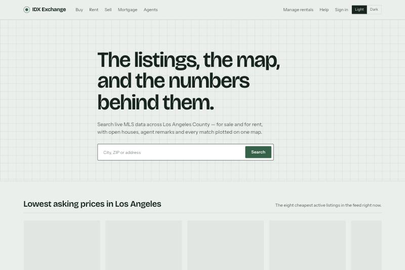
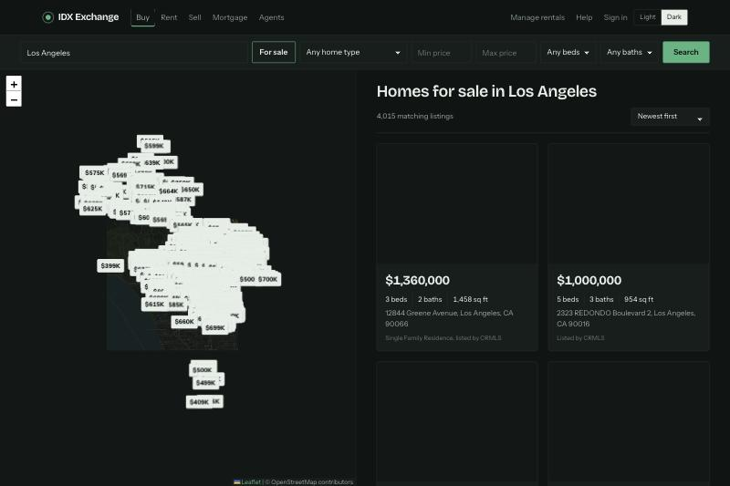

# IDX Exchange

A property search app backed by real MLS (IDX) data.
React (Vite) -> Express API -> MySQL 8. React never talks to MySQL directly.

Two visual styles share the same pages: the light style at `/` and the dark style
under `/redfin`. Switch with the Light | Dark control in the header; it keeps your
current page and query string.





### Frontend layout
- `src/styles/base.css` — design tokens (color, type, spacing) and element defaults. The dark
  style is the same tokens redefined under `[data-theme="dark"]`.
- `src/styles/app.css` — every component style.
- `src/site.js` — maps a path in one style tree to the same page in the other.
- `src/ui/Chrome.jsx` — header, footer, style switch, page frame.
- `src/ui/bits.jsx` — loading, error, filter bar and pagination.
- `src/pages/` — `HomePage`, `SearchPage` (serves both `/for-sale` and `/rent`),
  `DetailPage`, `MortgagePage`, `StaticPage`, `ListingsPage`.
- `src/components/PropertyCard.jsx` — the one listing card, used everywhere.

## Features
- Home page with the lowest-priced active listings and open-house badges
- `/for-sale` search: city/ZIP/address, price, beds, baths, type, sort, pagination
- `/rent` search: same filters and layout as `/for-sale`, scoped to lease listings (see `RENTAL_PROPERTY_TYPES` below)
- Interactive map showing every matching listing as a price pin (Leaflet + OpenStreetMap, no API key)
- Property detail page: photos, remarks, upcoming open houses, map (shows `/mo` pricing for rentals)
- Mortgage payment calculator; Sell, Find an agent and the other nav pages say they are not built yet

## Week 5: Listings page (`/listings`)
A plain grid of property cards, built per the Week 5 requirements of the challenge guide.
- `frontend/src/api/client.js`: `fetchProperties(params)` and `fetchPropertyDetail(id)`. All fetch/HTTP error handling lives here and throws user-readable messages.
- `frontend/src/pages/ListingsPage.jsx`: loading state, error state with a Try again button, and a "Showing 20 of 487 properties" count.
- `frontend/src/components/PropertyCard.jsx`: first photo, price, address, city/state, beds, baths, sqft, hover effect. Links to `/property/:id`.
- `frontend/src/utils/photos.js`: `parsePhotos` never throws; handles null, empty string, malformed JSON and non-array values. Cards fall back to "No photo available" when an image is missing or fails to load.
- `frontend/src/utils/format.js`: hides null/zero beds, baths, sqft and shows "Price unavailable" for null/zero price.
- The `/api` proxy to Express (port 5001) is configured in `frontend/vite.config.js`.

## Week 6: Filters UI + testing (`/listings`)
- `frontend/src/components/PropertyFilters.jsx`: controlled form with city, ZIP, min price, max price, beds and baths. All six values live in one state object updated with the spread operator. Submitting calls `onSearch` with only the non-empty values (`utils/filters.js` `compactFilters`), so the API never receives `?beds=`. **Clear Filters** resets the form and calls `onClear`.
- `frontend/src/pages/ListingsPage.jsx`: holds the submitted filters in state; an effect fetches whenever they change. Filters combine (`city` + `minPrice` + `beds` ...). Zero results shows a helpful "No properties found" message.
- `frontend/src/api/client.js`: `fetchProperties(params, { signal })` accepts an `AbortSignal`; an abort is rethrown as `AbortError` instead of being reported as "server unreachable".
- Tests (Vitest + Testing Library, run with `cd frontend && npm test`):
  `src/api/client.test.js` (URL building, empty values dropped, success, 400/404/500, network failure, abort) and
  `src/components/PropertyFilters.test.jsx` (six inputs render, combined submit, empty values omitted, Clear resets).

**Debug challenge: why the first results flashed.** Every Search or Clear starts a request, and responses do not always come back in the order they were sent. The slow response from the first search ("Irvine") could arrive after Clear and after the second Search had started, so it called `setData` and briefly showed old results until the newer response replaced them. The fix is in the effect: its cleanup runs `controller.abort()` before the next request starts, and every `.then/.catch/.finally` checks `signal.aborted` before touching state. Only the latest request can write to state.

**Concepts.**
- *Unit test*: a small automated check of one piece of code (a function or component) in isolation, with a clear expected result.
- *Mocking*: replacing a real dependency with a stand-in you control (`vi.fn()`, which is Jest's `jest.fn()`), so a test decides what the dependency returns and can check how it was called.
- *Why mock `fetch()`*: real requests need the server and database running, are slow, and make tests fail for reasons unrelated to our code. A mocked `fetch` makes tests fast and repeatable, and lets us test the error paths (500, network down) on demand.

## Week 9: Sorting (Option 1) + performance
**Sorting on `/listings`.** A "Sort by" dropdown next to the result count: price, date listed, square feet and beds, each in both directions.
- `GET /api/properties?sortBy=L_SystemPrice&sortOrder=desc` - `sortBy` is checked against a whitelist of **real SQL column names** in `backend/lib/propertyQuery.js` (`SORT_COLUMNS`). `ORDER BY` cannot be parameterised, so user input only ever *selects* a whitelist entry; it is never put into the SQL. An invalid `sortBy` or `sortOrder` returns `400 { error, details }` and never reaches MySQL.
- Rows with no value (NULL, or 0 price / sqft) always sort last, and `L_ListingID` breaks ties so pages never overlap.
- Frontend (`ListingsPage.jsx`, `components/SortControls.jsx`, `utils/sort.js`): the sort lives in page state, so it **persists across page changes**; applying or clearing filters **resets it to the default**. Choosing a new sort goes back to page 1 and keeps the filters.
- The date-listed column is `ListingContractDate` (`LISTED_DATE_COLUMN` in `propertyQuery.js` and `utils/sort.js`); it was confirmed with `SHOW COLUMNS FROM rets_property LIKE '%Date%';`.
- Tests: `backend/test/week9.test.js`, `frontend/src/utils/sort.test.js`, `components/SortControls.test.jsx`, and a "sorting" block in `pages/ListingsPage.test.jsx`.

**Performance.** EXPLAIN notes, new indexes, request timing, the React Error Boundary and the console-warning review are in
[`backend/docs/week9-performance.md`](backend/docs/week9-performance.md); SQL in `backend/sql/week9_explain.sql` and `backend/sql/week9_indexes.sql`.

## Prerequisites
Node.js (LTS), npm, Docker Desktop, and the two data files `rets_property.sql` and
`rets_openhouse.sql` (not included in this repo; obtain them from your IDX Exchange contact).

## 1. Start MySQL and import the data
```bash
docker run -d --name idx-mysql-local -p 3306:3306 \
  -e MYSQL_ROOT_PASSWORD=your_mysql_root_password -e MYSQL_DATABASE=rets mysql:8

docker exec -i idx-mysql-local mysql -uroot -pyour_mysql_root_password rets < rets_openhouse.sql
docker exec -i idx-mysql-local mysql -uroot -pyour_mysql_root_password rets < rets_property.sql
```
The property file is large; the import takes a few minutes.
Verify: `SELECT COUNT(*) FROM rets_property;` returns a non-zero number.
Next time, just `docker start idx-mysql-local`.

## 2. Run the API (port 5001)
```bash
cd backend
cp .env.example .env      # then set DB_PASSWORD
npm install
npm run dev
```
Check http://localhost:5001/api/health -> `{"status":"ok","database":"connected"}`.
(Port 5000 is avoided because macOS AirPlay uses it.)

Endpoints: `GET /api/health`, `GET /api/properties`, `GET /api/properties/map`,
`GET /api/properties/:id`, `GET /api/cities`.

### `GET /api/properties` (Week 3)
```
GET /api/properties?city=Irvine&minPrice=300000&beds=3&limit=20&offset=0
-> { "total": 87, "limit": 20, "offset": 0, "results": [...] }
```
| Param | Rules |
|-------|-------|
| `limit` | integer 1-100, default 20 |
| `offset` | integer >= 0, default 0 (`page` is accepted as a legacy alias) |
| `city` | case/space-insensitive match |
| `zipcode` | 5 digits |
| `minPrice`, `maxPrice` | non-negative numbers, `minPrice <= maxPrice` |
| `beds`, `baths` | minimums (`>=`) |
| `sort` | `newest` (default), `price_asc`, `price_desc` (older named sort, still supported) |
| `sortBy` | Week 9. An actual `rets_property` column: `L_SystemPrice`, `ListingContractDate`, `LM_Int2_3` (sq ft), `L_Keyword2` (beds). Anything else (including RESO names like `ListPrice`) is a 400. Overrides `sort`. |
| `sortOrder` | Week 9. `asc` (default) or `desc`, any casing. |

Invalid input returns `400 { "error": "Invalid query parameters", "details": ["limit must be between 1 and 100", ...] }`.
Indexes: `backend/sql/week3_indexes.sql`; EXPLAIN notes: `backend/docs/week3-explain.md`.
Tests: `cd backend && npm test` (no database needed).

`GET /api/properties` and `/api/properties/map` accept `category=rent` (or `sale`) to
scope results to lease vs. for-sale listings, based on `L_Type_`. Which type strings count
as rentals is configured via `RENTAL_PROPERTY_TYPES` in `backend/.env` (defaults to
`ResidentialLease,Apartment`) — check `SELECT DISTINCT L_Type_ FROM rets_property` against
your actual MLS feed and adjust if it uses different values, or the `/rent` page will just
come back empty.

## 3. Run the frontend
```bash
cd frontend
npm install
npm run dev
```
Open the URL Vite prints (http://localhost:3000, or 3001 if 3000 is taken).
Vite proxies `/api` to `http://localhost:5001` (see `frontend/vite.config.js`).

## Notes
- Never commit `.env` or the SQL files.
- Listing data is MLS data; use it only as your IDX Exchange access permits.
